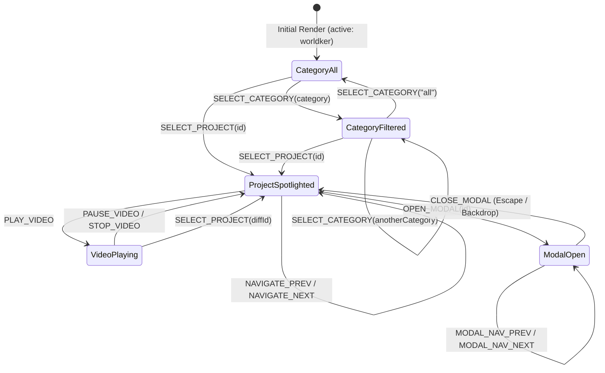

# Data Model & State Transitions: Projects Section Redesign

**Feature**: `005-projects-section-redesign`
**Created**: 2026-10-11
**Status**: Completed

## 1. Entity Definitions

### 1.1 Project Entity

Represents an authentic engineering project exhibited within the portfolio showcase.

```typescript
export type ProjectCategory = "all" | "mobile" | "web" | "enterprise_pwa";

export interface ProjectRecord {
  /** Unique project identifier matching translation dictionary keys */
  id: string;
  /** Categorization discipline for filtering */
  category: "mobile" | "web" | "enterprise_pwa";
  /** Path to the high-resolution raster/vector preview asset */
  imageUrl: string;
  /** Optional path to a high-definition video demonstration asset */
  videoUrl?: string;
  /** List of verified technical skills, libraries, and tools used */
  technologies: string[];
  /** Flag marking whether the project is featured as the default showcase hero */
  featured?: boolean;
}

export interface LocalizedProject extends ProjectRecord {
  /** Localized display title resolved from language dictionary */
  title: string;
  /** Localized summary narrative resolved from language dictionary */
  description: string;
  /** Localized category name */
  categoryLabel: string;
  /** Formatted ordinal index string (e.g. "01", "02") */
  indexString: string;
}
```

### 1.2 Category Filter Entity

Represents a selectable discipline filter tab.

```typescript
export interface CategoryFilterItem {
  id: ProjectCategory;
  /** Localized title string for the filter button */
  label: string;
  /** Number of projects matching this category in the current catalog */
  count: number;
  /** Accessibility label for screen readers */
  ariaLabel: string;
}
```

### 1.3 Verified Projects Catalog

The static catalog of all 9 verified projects:

| ID | Title (ES / EN) | Category | Media Assets | Technologies |
| :--- | :--- | :--- | :--- | :--- |
| `worldker` | Aplicación Móvil Worldker / Worldker Mobile App | `mobile` | `/worldker.png`, `/video2.mp4` | React Native, Firebase, i18n, MySQL, Git |
| `arzobispadoWeb` | Portal Institucional Arzobispado / Archdiocese Institutional Portal | `web` | `/arzobispado.webp` | React, Next.js, CSS, SEO |
| `arzobispadoCrud` | Sistema de Gestión del Arzobispado / Archdiocese Management System | `enterprise_pwa` | `/crud.webp` | Node.js, MySQL, Express, React |
| `alcaldia` | Plataforma de Eventos Alcaldía de Medellín / Town Hall Medellin Event Platform | `web` | `/projects/Alcaldia.webp` | React, Node.js, PostgreSQL |
| `autovidrios` | Sistema de Gestión Auto Vidrios / Auto Vidrios Management System | `enterprise_pwa` | `/projects/AutoVidrios.webp` | React, Node.js |
| `fiado` | PWA Financiera Fiado / Fiado Financial PWA | `enterprise_pwa` | `/projects/Fiado.webp` | PWA, React, Node.js |
| `jccrp` | Sistema de Inventario Distribuciones J.C.C.R.P. / Distribuciones J.C.C.R.P. Inventory System | `enterprise_pwa` | `/projects/Jccrp.webp` | React, Node.js |
| `perfecttrainer` | Aplicación Móvil Perfect Trainer / Perfect Trainer Mobile App | `mobile` | `/projects/perfecttrainer.webp` | React Native, Firebase, Redux |
| `tourtrack` | Aplicación Móvil Nativa TourTrack / TourTrack Native Mobile App | `mobile` | `/projects/TourTrack.webp` | React Native, Firebase |

---

## 2. Component State Model

The interactive state managed by `MyProjects` and its sub-components:

```typescript
export interface ProjectsShowcaseState {
  /** Currently selected discipline filter */
  selectedCategory: ProjectCategory;
  /** ID of the currently spotlighted project in the hero stage */
  activeProjectId: string;
  /** Whether the detailed inspection modal is currently visible */
  isModalOpen: boolean;
  /** Whether video preview playback is currently running */
  isVideoPlaying: boolean;
  /** Whether the component is rendering with reduced-motion constraints */
  reducedMotion: boolean;
}
```

---

## 3. State Transitions & Invariants



### Invariants:
1. **Catalog Integrity**: The 9 verified projects are never mutated, removed, or fabricated.
2. **Category Coherence**: Selecting a category immediately selects the first project within that category if the current active project does not belong to it.
3. **Circular Navigation**: `NAVIGATE_NEXT` on the last project wraps to index 0; `NAVIGATE_PREV` on index 0 wraps to the last project of the active filtered subset.
4. **Media Isolation**: When changing projects, any active video playback is immediately terminated and reset to prevent audio bleed or unmounted element errors.
5. **Modal Focus Trap**: When `isModalOpen` is true, keyboard focus is contained within the modal dialog. Closing the modal restores focus to the triggering element.
