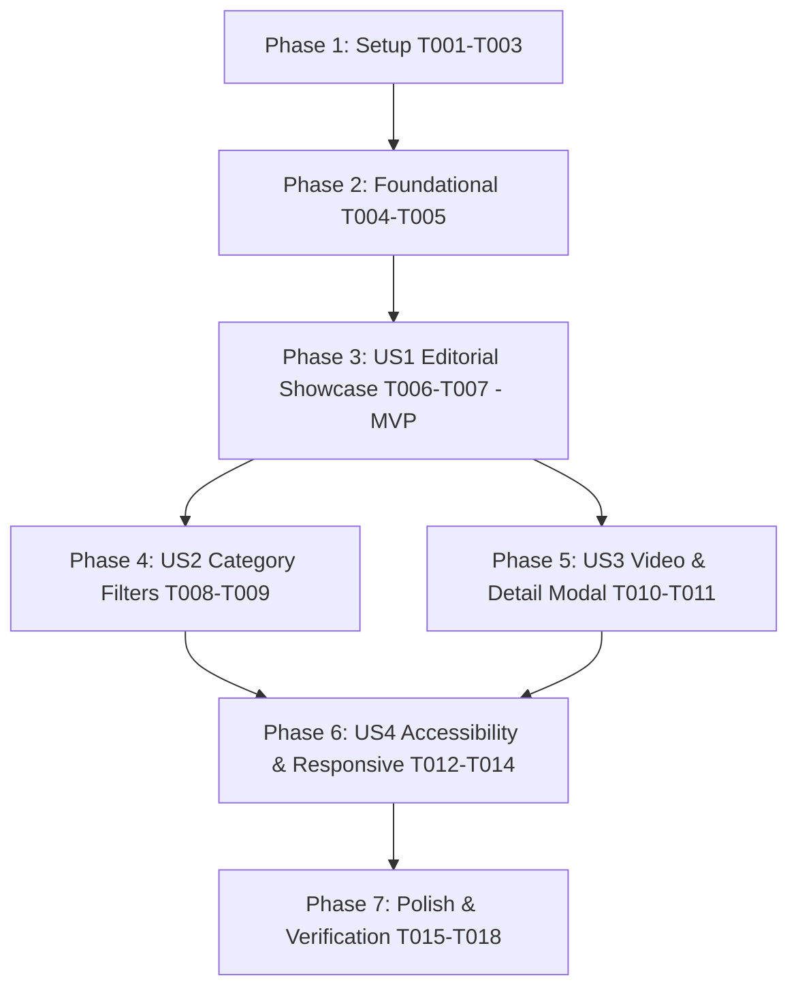

# Tasks: Interactive Projects Section Redesign

**Feature**: `005-projects-section-redesign`
**Created**: 2026-10-11
**Spec**: [specs/005-projects-section-redesign/spec.md](file:///Users/user/Desktop/portafolio/mi-portafolio/specs/005-projects-section-redesign/spec.md)
**Plan**: [specs/005-projects-section-redesign/plan.md](file:///Users/user/Desktop/portafolio/mi-portafolio/specs/005-projects-section-redesign/plan.md)

---

## Phase 1: Setup (Shared Infrastructure)

**Purpose**: Initialize static catalog and localization dictionaries for the redesigned showcase.

- [X] T001 [P] Create projects data catalog with all 9 authentic projects in `components/myProjects/projectsData.ts`
- [X] T002 [P] Update Spanish localization dictionary with projects showcase namespace in `locales/es.json`
- [X] T003 [P] Update English localization dictionary with projects showcase namespace in `locales/en.json`

---

## Phase 2: Foundational (Blocking Prerequisites)

**Purpose**: Core UI sub-components that MUST be complete before the primary section orchestrator can be assembled.

**⚠️ CRITICAL**: Foundational components must be created before assembling user stories in Phase 3.

- [X] T004 Implement ProjectSpotlightStage component with responsive aspect ratio and image fallback in `components/myProjects/ProjectSpotlightStage.tsx`
- [X] T005 Implement ProjectDeck component with project metadata, ordinal counter, narrative, tech badges, and steppers in `components/myProjects/ProjectDeck.tsx`

**Checkpoint**: Foundation ready - User Story 1 implementation can now proceed.

---

## Phase 3: User Story 1 - Interactive Editorial Showcase & Visual Focus Stage (Priority: P1) 🎯 MVP

**Goal**: Deliver a high-impact editorial showcase displaying the featured project (Worldker) and all 9 authentic projects with seamless navigation, crisp typography, and zero 3D Three.js canvas overhead.

**Independent Test**: Navigate to `#projects`, verify Worldker renders with `01 / 09`, title, description, and tech badges, and verify stepping through projects updates the spotlight smoothly without 3D canvas dependencies.

### Implementation for User Story 1

- [X] T006 [US1] Create the primary MyProjects section orchestrator replacing ProjectCube with the editorial showcase stage and deck in `components/myProjects/page.tsx`
- [X] T007 [US1] Update home page import and anchor integration to render the redesigned MyProjects showcase in `app/page.tsx`

**Checkpoint**: At this point, User Story 1 is fully functional as a standalone MVP showcase.

---

## Phase 4: User Story 2 - Discipline & Category Filtering (Priority: P2)

**Goal**: Allow visitors and recruiters to filter projects across 4 disciplines ("Todos", "Apps Móviles", "Plataformas Web", "Sistemas y PWAs"), updating counters and active items dynamically.

**Independent Test**: Click each category filter, verify that the project counter updates (e.g. `01 / 03` for mobile) and the spotlight auto-selects the first project in that category.

### Implementation for User Story 2

- [X] T008 [P] [US2] Implement ProjectFilters component with accessible category tabs and counts in `components/myProjects/ProjectFilters.tsx`
- [X] T009 [US2] Integrate ProjectFilters into `components/myProjects/page.tsx` with dynamic category filtering and active project synchronization

**Checkpoint**: Category filtering operates seamlessly alongside the core showcase.

---

## Phase 5: User Story 3 - Interactive Media Preview & Deep-Dive Inspection (Priority: P3)

**Goal**: Allow visitors to trigger video playback for Worldker (`/video2.mp4`) with default muted audio and open an accessible modal dialog for deep-dive technical inspection of all projects.

**Independent Test**: Click play on Worldker to verify seamless video playback, and click "Ver Detalles" to verify the inspection modal opens with full tech badges, navigation arrows, and `Escape` key dismissal.

### Implementation for User Story 3

- [X] T010 [P] [US3] Implement accessible ProjectDetailModal dialog with focus trap and keyboard navigation in `components/myProjects/ProjectDetailModal.tsx`
- [X] T011 [US3] Integrate video playback controls and ProjectDetailModal into `components/myProjects/page.tsx` and `components/myProjects/ProjectSpotlightStage.tsx`

**Checkpoint**: Video demonstration and deep-dive inspection modal operate independently and reliably.

---

## Phase 6: User Story 4 - Accessible & Responsive Cross-Device Navigation (Priority: P4)

**Goal**: Ensure the projects section is 100% WCAG 2.2 AA compliant, fully responsive across 320px to 4K viewports, keyboard-navigable (`Tab`, `Enter`, `ArrowLeft`, `ArrowRight`), and respects `prefers-reduced-motion`.

**Independent Test**: Test keyboard-only navigation across all controls, test on mobile viewport (375px), and emulate `prefers-reduced-motion` to confirm animations are suppressed.

### Implementation for User Story 4

- [X] T012 [P] [US4] Add visible focus rings, ARIA labels, and keyboard listeners (`ArrowLeft`, `ArrowRight`, `Escape`) in `components/myProjects/page.tsx`
- [X] T013 [P] [US4] Implement mobile-responsive layout adjustments and minimum 44x44px touch targets in `components/myProjects/ProjectDeck.tsx` and `components/myProjects/ProjectSpotlightStage.tsx`
- [X] T014 [US4] Add reduced-motion detection and animation suppression for Framer Motion in `components/myProjects/page.tsx`

**Checkpoint**: Full compliance with WCAG 2.2 AA, responsive ergonomics, and reduced-motion requirements verified.

---

## Phase 7: Polish & Cross-Cutting Concerns

**Purpose**: Cleanup legacy 3D canvas files, verify i18n completeness, and execute end-to-end verification.

- [X] T015 [P] Deprecate and remove legacy Three.js canvas component file in `components/ProjectCube/page.tsx`
- [X] T016 [P] Verify 100% translation key parity between `locales/es.json` and `locales/en.json`
- [X] T017 Run end-to-end quickstart validation scenarios from `specs/005-projects-section-redesign/quickstart.md`
- [X] T018 Execute automated linting and Next.js static build checks via `npm run lint` and `npm run build`

---

## Dependencies & Execution Order

### Phase Dependencies

- **Setup (Phase 1)**: No dependencies - can start immediately.
- **Foundational (Phase 2)**: Depends on Phase 1 completion - BLOCKS all user stories.
- **User Story 1 (Phase 3 - MVP)**: Depends on Phase 2 completion. Delivers the core editorial showcase.
- **User Story 2 (Phase 4)**: Depends on Phase 3 completion. Adds category discipline filtering.
- **User Story 3 (Phase 5)**: Depends on Phase 3 completion. Adds video playback and detail modal.
- **User Story 4 (Phase 6)**: Depends on Phases 3-5 completion. Finalizes accessibility, touch targets, and motion controls.
- **Polish (Phase 7)**: Depends on all user stories being complete.

### User Story Dependencies

---

## Parallel Opportunities

- **Phase 1 (Setup)**: Tasks `T001`, `T002`, `T003` can execute in parallel (different files).
- **Phase 2 (Foundational)**: Tasks `T004` and `T005` can execute in parallel.
- **Phase 4 & 5**: Once User Story 1 is in place, User Story 2 (`T008`) and User Story 3 (`T010`) can be authored in parallel.
- **Phase 7 (Polish)**: `T015` and `T016` can run in parallel before final build checks `T017` and `T018`.

---

## Implementation Strategy

### MVP First (User Story 1 Only)
1. Complete Phase 1 (Data catalog & i18n setup).
2. Complete Phase 2 (Foundational components `ProjectSpotlightStage` & `ProjectDeck`).
3. Complete Phase 3 (Assemble `MyProjects` orchestrator).
4. **Validate MVP**: Browse all 9 authentic projects in the spotlight stage with zero 3D Three.js canvas overhead.

### Incremental Delivery
1. Foundation + US1 → Working editorial showcase (MVP).
2. Add US2 → Category filtering by mobile, web, and enterprise domains.
3. Add US3 → Video demo player & deep-dive inspection modal.
4. Add US4 → Full WCAG 2.2 AA accessibility, keyboard navigation & reduced motion.
5. Polish → Retire legacy Three.js cube, verify translations, run `npm run lint` and `npm run build`.
